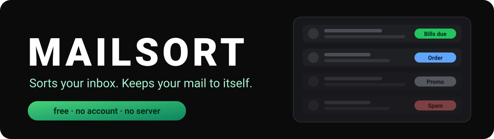
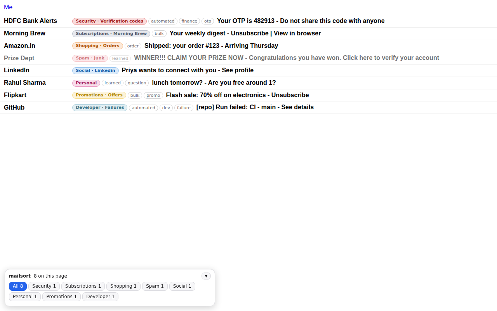
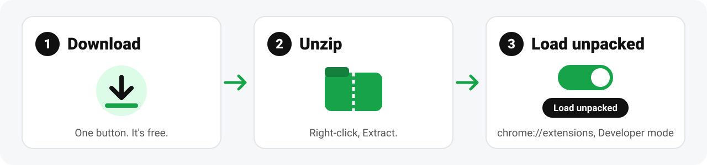
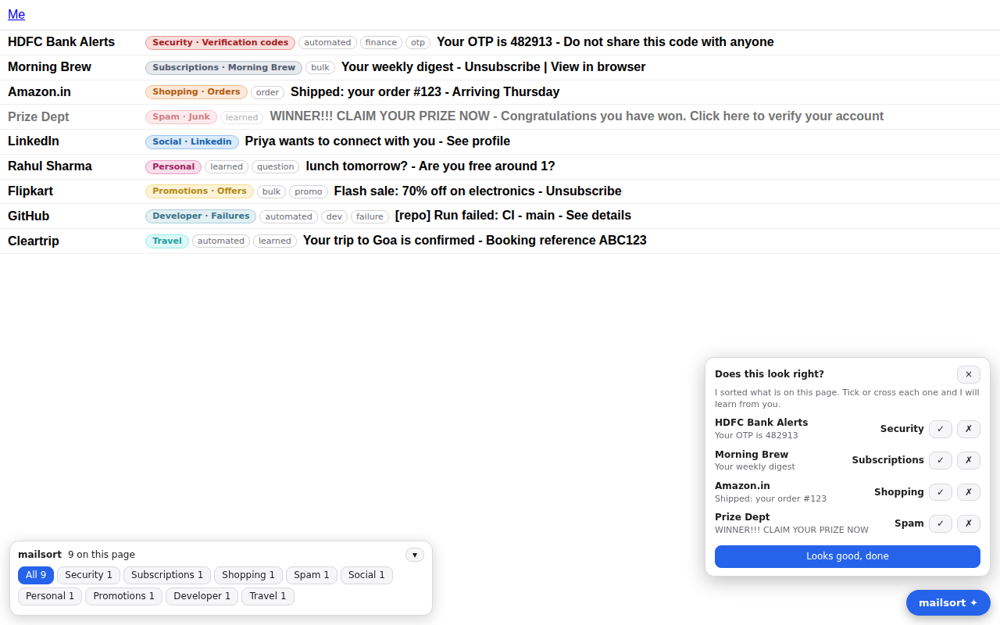
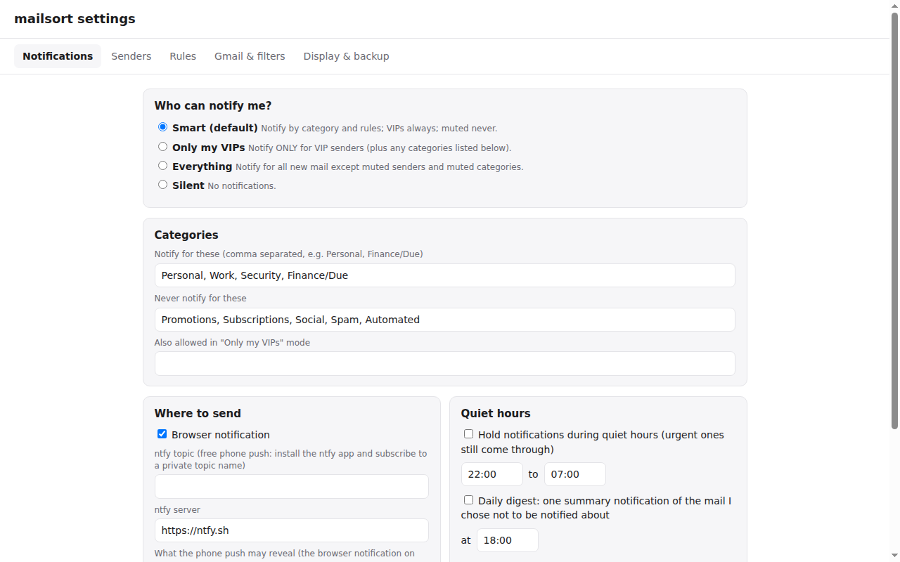
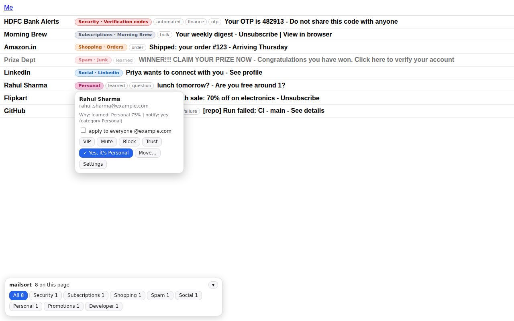
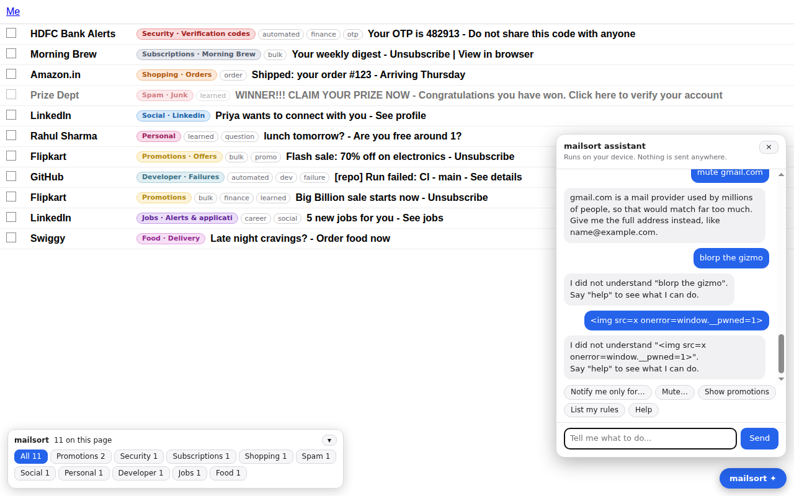
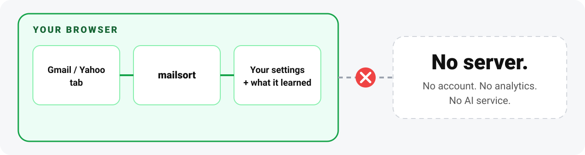
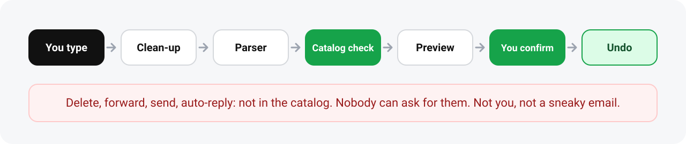

<p align="center">
  
</p>

<p align="center">
  <a href="https://nayan-mis.github.io/mailsort/"></a>
  &nbsp;
  <a href="https://github.com/nayan-mis/mailsort/actions/workflows/ci.yml"></a>
  <a href="LICENSE"></a>
  <a href="PRIVACY.md"></a>
</p>

<p align="center"><b>Your inbox is 3% people and 97% companies shouting.<br>This sorts the shouting. On your computer. Nobody else gets a copy.</b></p>

<p align="center">
  <br>
  <sub>Demo inbox. Every sender is made up, including the ones that sound too real.</sub>
</p>

---

## Install



<p align="center">Chrome, Edge or Brave on a computer. About forty seconds, one scary-looking switch, zero terminals.<br>
<sub>Chrome wants Developer mode for anything outside its store. We are not in the store yet. The whole source is right here if you want to check what you are loading.</sub></p>

---

## What you get

| | | |
|:---:|:---:|:---:|
| 🏷️<br>**Badges**<br><sub>category, subcategory and tags on every email</sub> | 🚨<br>**Spam flags**<br><sub>shady and look-alike senders get dimmed</sub> | 🔔<br>**Notifications on your terms**<br><sub>Smart, Only my VIPs, Everything, Silent</sub> |
| 💬<br>**A chat box**<br><sub>type "mute linkedin", it does that</sub> | 🧠<br>**It learns**<br><sub>from your corrections, on your device</sub> | 📱<br>**Rules on your phone**<br><sub>export them as Gmail filters</sub> |
| 👥<br>**Several accounts**<br><sub>Gmail ones are picked up automatically</sub> | 🇮🇳<br>**Hindi and Hinglish**<br><sub>built-in examples</sub> | 🌙<br>**Small comforts**<br><sub>Undo everywhere, dark mode, keyboard support</sub> |

<sub>Every setting is in [docs/features.md](docs/features.md).</sub>

---

## First five minutes

<table>
<tr>
<td width="33%" align="center"><br><b>1. Tick or cross</b><br><sub>A card asks "Does this look right?". Your answers teach it.</sub></td>
<td width="33%" align="center"><br><b>2. Pick who can buzz you</b><br><sub>Try "Only my VIPs". Your phone will go quiet.</sub></td>
<td width="33%" align="center"><br><b>3. Click any badge</b><br><sub>VIP, mute, block, trust, move, or see why it was sorted that way.</sub></td>
</tr>
</table>

---

## The chat box

<table>
<tr>
<td width="50%"></td>
<td width="50%">

| You type | It does |
|---|---|
| `Mute linkedin, facebook and quora` | mutes all three |
| `Notify me only for boss@example.com` | VIPs only |
| `Move swiggy to Food/Delivery` | re-files the sender |
| `If the subject contains invoice, tag it bills` | makes a rule |
| `Quiet hours 10pm to 7am` | schedules silence |
| `Select all from flipkart` | ticks them, you press Delete |
| `Undo` | undoes it |

</td>
</tr>
</table>

<sub>It is not ChatGPT. It knows a fixed set of phrasings, and when it does not get you, it says so. It also refuses dumb requests, like muting all of Gmail. Full list: [docs/assistant.md](docs/assistant.md).</sub>

---

## Privacy



| | |
|---|---|
| ✅ | Your settings and what it learned live in your browser. **Delete everything** wipes them. |
| ✅ | Exactly two network calls exist: Gmail's own unread feed, and a push server you choose, only if you switch it on. |
| ✅ | A test fails the build if anyone adds a network call, a permission, remote code or a real-looking email address. Including me. |
| ❌ | No account, no analytics, no AI service, no "insights". |

<sub>Full policy: [PRIVACY.md](PRIVACY.md). Every permission explained: [docs/permissions.md](docs/permissions.md).</sub>

---

## How it works



<sub>Everything it can do lives in one fixed catalog, each item with a risk level. [docs/architecture.md](docs/architecture.md) has the details, [docs/catalog.md](docs/catalog.md) has the list. Email text is only ever displayed, never obeyed.</sub>

---

## Honest status: public beta

| | |
|:---:|---|
| ✅ | Rules, learner, assistant and catalog have unit tests. The privacy audit runs on every change. |
| ✅ | 85 checks drive the real extension in Chromium against a mock inbox. |
| ⚠️ | **Not tested on real Gmail and real Yahoo Mail.** I built the mock inbox myself, so of course it agrees with me. Both sites change their layout whenever they like. |
| 🧪 | The optional on-device AI model is experimental. No model ships, and the code has never met real weights. |

**To find out fast:** toolbar icon, then **Check this page**. It says how many emails it can see. A bug report from a real inbox is the most useful thing you can send.

<details>
<summary><b>What it will not do</b></summary>

- It works on the inbox list you have open, a page at a time. Not your whole mailbox.
- It reads sender, subject and the preview line, not full bodies, so its spam sense is rougher than a mail server's.
- Extensions do not run in the Gmail or Yahoo phone apps. Exported Gmail filters are how rules reach your phone.
- Yahoo often hides the sender address in the list, so it matches on display name, and alerts only work while a Yahoo tab is open.

</details>

<details>
<summary><b>Troubleshooting</b></summary>

- **No badges, or "found 0 emails".** Reload the mail tab once, and make sure you are on the inbox list, not inside an email. Still nothing? The layout probably changed. Open an issue and paste what **Check this page** printed.
- **No background alerts for Gmail.** *Settings, Gmail and filters* shows each account's status. The background check uses Gmail's unread feed, which is not an official API, so it can break. Turn it off and alerts work while a Gmail tab is open.

</details>

---

## Roadmap

| | |
|:---:|---|
| ✅ | Sorting, notifications, chat box, learner, filter export, privacy audit |
| 🔜 | Check against live Gmail and Yahoo. The big one. |
| 🔜 | Store listings (Chrome, Edge, Firefox) so install is one click |
| 💭 | Small model for looser wording, then bigger optional ones |
| 💭 | Android app for notification filtering |
| 💭 | Whole-mailbox clean-up through the Gmail API (needs Google's app verification, which is its own adventure) |

---

## For developers

<details>
<summary><b>Commands and layout</b></summary>

```sh
sh scripts/publish.sh             # fills in your GitHub name, creates the repo, turns on Pages, pushes (needs the gh CLI)
npm test                          # unit tests, catalog tests, privacy audit (Node 18+, no dependencies)
sh scripts/build.sh               # builds dist/mailsort-<version>.zip and the website download
sh scripts/run-browser-tests.sh   # real Chromium against a mock inbox (needs Playwright, see tests/README.md)
node scripts/export-catalog.js    # regenerate docs/catalog.md after touching the catalog
```

```text
extension/        the extension (plain JavaScript, no build step, no third-party code)
  src/core/       rules engine, learner, catalog, command parser, text normalizer
  src/content/    what runs inside Gmail and Yahoo: badges, filter bar, chat box
  src/background/ notifications, the Gmail unread-feed check, the optional model host
  src/pages/      settings page and toolbar popup
  src/ai/         the hidden page for an optional on-device model
tests/            unit tests (Node) and browser tests (Python and Playwright)
training/         training-data generator and scorer for the optional model
scripts/          build, publish, catalog docs generator
docs/             documentation and the website
```

From source: `git clone https://github.com/nayan-mis/mailsort.git`, then **Load unpacked** on the `extension/` folder. Nothing to `npm install`. The extension has no dependencies, on purpose.

</details>

## Contributing

Small fixes are welcome: a rule, a phrase the chat box should learn, a selector that broke when Gmail moved something. Read [CONTRIBUTING.md](CONTRIBUTING.md), be decent ([Code of Conduct](CODE_OF_CONDUCT.md)), and send security problems through [SECURITY.md](SECURITY.md), not a public issue.

## License

[MIT](LICENSE). Not affiliated with or endorsed by Google or Yahoo. They did not ask for this either.
